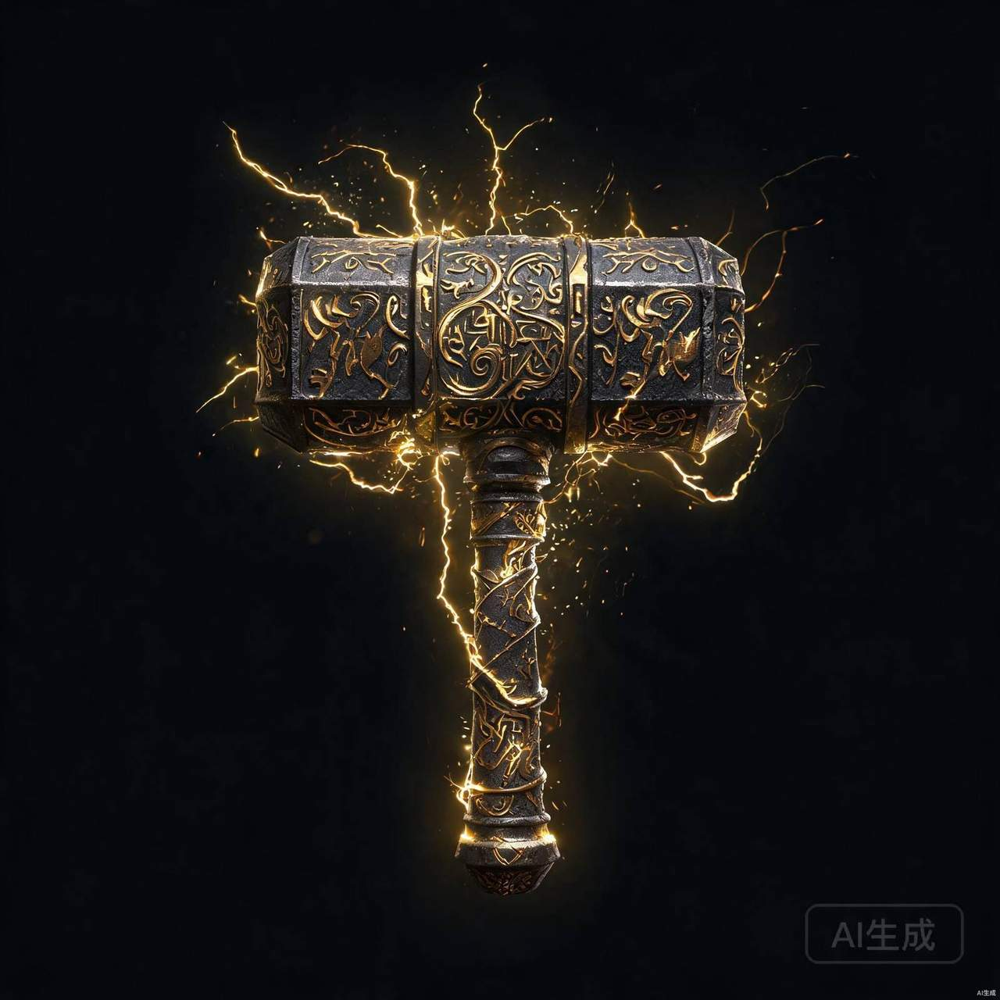
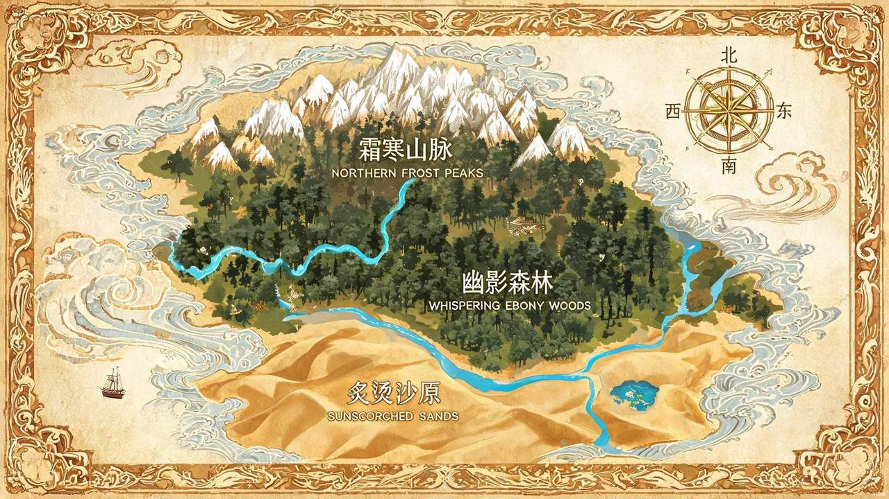
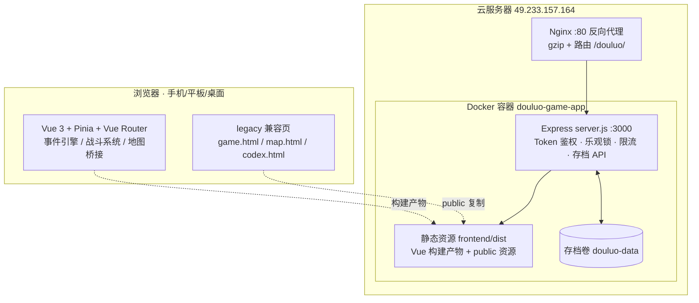

# 斗罗大陆 · 魂师之路

> 一款以《斗罗大陆 1》为正典基准的单机文字 RPG（Web 版）
> 版本 v1.0 · 2026-08 · 在线地址：http://49.233.157.164/douluo/

---

## 目录

1. [项目简介](#一项目简介)
2. [设计原则](#二设计原则)
3. [游戏体验——四大阶段](#三游戏体验四大阶段)
4. [核心系统](#四核心系统)
5. [内容规模](#五内容规模)
6. [技术架构](#六技术架构)
7. [部署与运维](#七部署与运维)
8. [质量保障](#八质量保障)
9. [版本历史](#九版本历史)
10. [后续规划](#十后续规划)

---

## 一、项目简介

《斗罗大陆·魂师之路》是一款**单机向的文字冒险 RPG**：玩家从武魂觉醒开始，经历学院求学、森林猎环、大陆游历，最终踏上封神之路。游戏以《斗罗大陆 1》原著为唯一正典基准，后续系列作品仅作素材参考，力求"对的时间遇到对的故事"。

| 项目 | 说明 |
|---|---|
| 类型 | 文字 RPG / 放置式单机体验 |
| 平台 | Web（手机 / 平板 / 桌面浏览器，全端无滚动适配） |
| 在线入口 | `http://49.233.157.164/douluo/` |
| 存档 | 浏览器本地 + 云端（服务器存档卷，多端同步） |
| 开发栈 | Vue 3 + Node.js Express + Docker + Nginx |

*星斗大森林——魂师最初的试炼场（游戏内场景素材）*

---

## 二、设计原则

游戏内容与系统遵循**统一标尺**（由玩家、执行 agent 与审查 agent 三方共建，见 `docs/reports/玩家预期与剧情逻辑统一标尺.md`）：

1. **读得通**：剧情文本与《斗罗大陆 1》正典一致，不出现跨时代概念（魂导器、位面、轮回等仅保留钢铁之城分类关键词）；
2. **选得动**：每个选择都有意义——不同选项有不同结果，命运值、出身、羁绊影响可选项；
3. **记得住**：图鉴联动"已见"角标、结局多样、冒险日记记录旅程。

**正典红线**：唐三等同辈同行（非学长身份）；最终主线为讨伐武魂殿（非深渊之主）；十万年魂环需命运值门槛（原著级稀有度）。

---

## 三、游戏体验——四大阶段

### ① 觉醒期（1~10 级）

出身选择（星斗小村 / 武魂城世家 / 边境小城 / 海神岛渔村）决定初始属性与专属事件线；武魂觉醒池含蓝银草、昊天锤、天使神剑等数十种武魂——神级武魂人人可得，但描述与原著人物解耦，故事由你书写。

  

*左：蓝银草武魂 · 右：昊天锤武魂（觉醒图鉴素材）*

### ② 进阶学院（10~40 级）

史莱克学院生活：课堂、食堂、宿舍、对练；唐三以同学身份与你同行；弗兰德院长、赵无极老师 12 级后登场；30~40 级迎来魂师大赛（预赛→决赛），对应原著节奏。

### ③ 历练期（40~70 级）

猎取魂环是核心：20 级百年黄环、30 级千年紫环、40 级千年、50 级万年……吸收魂环有**反噬风险**（百年 85% 成功率递减至百万年 20%），失败受伤且需休整；猎场魂兽按原著生态分布（星斗大森林核心圈的人面魔蛛、深海魔鲸王等）。

  

*左：人面魔蛛（万年猎场）· 右：深海魔鲸王（80 级深海争锋）*

### ④ 封神期（70~100 级）

70 级后十万年魂环需命运值 ≥5、百万年需 ≥10；主线终章为**讨伐武魂殿**——武魂城教皇殿前对决圣殿大供奉；海神九考、神界诸事件、多结局结算（海神传承者 / 守护斗罗 / 暗影主宰 / 逍遥游侠……）。

*武魂城·教皇殿——最终决战的舞台*

---

## 四、核心系统

| 系统 | 说明 |
|---|---|
| 行动/时间 | 1 行动 = 1 时间，季节（4 行动轮换）与时段门控事件 |
| 战斗 | 属性克制 + 元素共鸣 + 连击 + 训练战斗回调；战败扣 5% 金币 |
| 魂环 | 10 个魂环位，年限与吸收成功率挂钩，失败有反噬与冷却 |
| 命运值 | 剧情抉择累积，解锁十万年/百万年魂环与高门槛结局 |
| 经济 | 训练（5 档性价比）、经验丹、商店、拍卖行；满级经验自动转金币 |
| 锻造 | 魂骨锻造（至尊之骨 50% 成功率）、装备打造 |
| 挑战塔 | 20 层试炼，首通魂骨奖励，失败 5 行动冷却 |
| 图鉴 | 武魂/魂兽/NPC/魂骨/地点/魂环六类图鉴，冒险中"已见"自动打标 |
| 大地图 | 战争迷雾 + 隐藏地点 + 快速旅行 + 随机遭遇 |
| 存档 | 本地 + 云端双通道，乐观锁防冲突，5 份历史归档 |

*斗罗大陆世界地图——战争迷雾、隐藏地点与快速旅行（地图背景素材）*

---

## 五、内容规模

| 内容 | 数量 |
|---|---|
| 剧情事件 | 541 个（含 9 个魂环猎取事件，364 个已按阶段重标） |
| 武魂图鉴 | 70 种 |
| 魂兽图鉴 | 30 种 + 30 种年限变体 |
| NPC | 34 名（含唐三、小舞、大师等正典角色与赵铁山、陈默等原创角色） |
| 魂骨 / 地点 / 魂环 | 31 / 28 / 12 种 |
| 数据文件 | 13 个 JSON（702KB），全部纳入版本控制 |
| 美术资源 | 266 张图（34MB，全量压缩至 1280px 上限） |

---

## 六、技术架构

**前端**：Vue 3 单页应用（`frontend/src`），核心模块：

| 模块 | 职责 |
|---|---|
| `engine/` | 规则引擎（阶段表 10/40/70）、事件索引、事件适配（季节/出身/等级门控） |
| `composables/` | 事件引擎、战斗系统（Boss 武魂殿线）、游戏规则、功能开关 |
| `data/` | 事件库 541 条、游戏数据、地点事件 |
| `utils/` | 资源解析（中英文文件名映射）、地图桥接 |

**后端**：Express 单文件服务（`server.js`）——静态托管、玩家存档 API（HMAC 鉴权、`_serverVersion` 乐观锁、v1~v5 归档、限流、CSP 安全头）。

---

## 七、部署与运维

| 项 | 值 |
|---|---|
| 服务器 | 腾讯云 49.233.157.164，应用目录 `/opt/apps/douluo` |
| 容器 | `douluo-game-app`（重启策略 unless-stopped，限 768M 内存） |
| 应用端口 | 仅监听 `127.0.0.1:3001`，不对外暴露 |
| 存档 | Docker 命名卷 `douluo-data`（**删除即丢失存档**） |
| 健康检查 | `GET /api/health`（容器 HEALTHCHECK + 运维脚本双重） |
| 更新流程 | 本地 `npm run build` → 打包 `dist` → scp 上传 → `docker compose build && up -d` → 健康检查 |

> 同服务器还运行 mc-glm（我的世界）与 sub2api 服务，互不影响。

---

## 八、质量保障

| 保障 | 规模 |
|---|---|
| 单元/集成测试 | **301 项**（Node 层 65 + Vitest 层 236），覆盖事件引擎/战斗/存档/快照/回归 |
| 事件快照测试 | 固定随机种子 30 连抽基线，任何事件池变化可追溯 |
| 数据校验 | `validate:data`：13 个 JSON + 事件阶段/等级区间一致性 |
| 资源审计 | 541 事件图片引用全库校验 0 缺失 |
| 全库审查 | 第一轮 19 项修复经 GLM 全面复核（11 commit 全过，报告见 `docs/reports/第一轮修复复核报告-GLM.md`） |

---

## 九、版本历史

| Commit | 内容 |
|---|---|
| `790f2d6` | T1 神级武魂与正典解耦 + .gitignore 修正 |
| `78c5637` | T2 移除斗罗 II 人物（戴雨浩 / 徐三石） |
| `c900d3f`+`ecbccc1` | T3 魂导器/位面/轮回概念清理，13 处数据层改写 |
| `20b3b32` | T4 出身限定事件（12 条 or_* + 引擎 requiredOrigin） |
| `acd7876` | T5+T5b 现代梗清理 + SEJ 占位符 75 处修正 |
| `dca63e2` | T7 唐三降同辈、弗兰德/赵无极 12 级解锁 |
| `3e91b62` | T6b 最终 Boss 武魂殿化（圣殿大供奉） |
| `ae96dd2` | T6 阶段表 10/40/70 重划 + 364 事件全量重标 |
| `c319b1c` | T8/T10/T12/T14/T15/T17 机制修复六项（命运门槛/千年环/猎场生态/满级转金币/魂骨/季节门控） |
| `2ad8526` | T9/T13/T16/T18/T19（吸收反噬/战败代价/图鉴联动/新 NPC/经济调平） |
| `d5de2a4` | N1 legacy 层同步主线修复（GLM 复核 3 项新问题之首） |
| `fec60e4` | no-scroll 全端无下滑改造（Vue + legacy 三页） |
| `70565bd` | 图片全量压缩 114MB→34MB + 修复 40 处资源 404 |

---

## 十、后续规划

- [ ] **N2**：1~10 级事件池扩充（当前偏薄，快照重复率高，目标补 8~12 条）
- [ ] 域名接入（gyc1313.tech）与 HTTPS（certbot），当前为 IP 直访
- [ ] 真机全端实测（无下滑改造的最终验收）
- [ ] 正典细节定案：唐三第一魂环年限、泰坦巨猿年限
- [ ] SEJ 168 事件三模板差异化（内容创作，另行排期）

---

*说明书版本：v1.0（2026-08-15）· 生成依据：仓库当前 HEAD `70565bd`*
